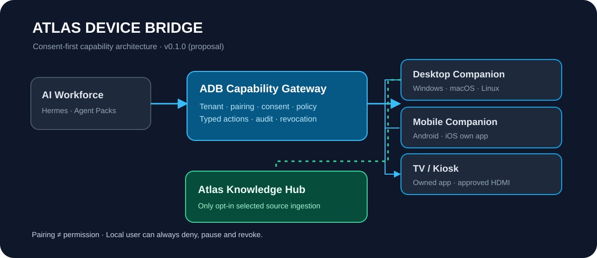
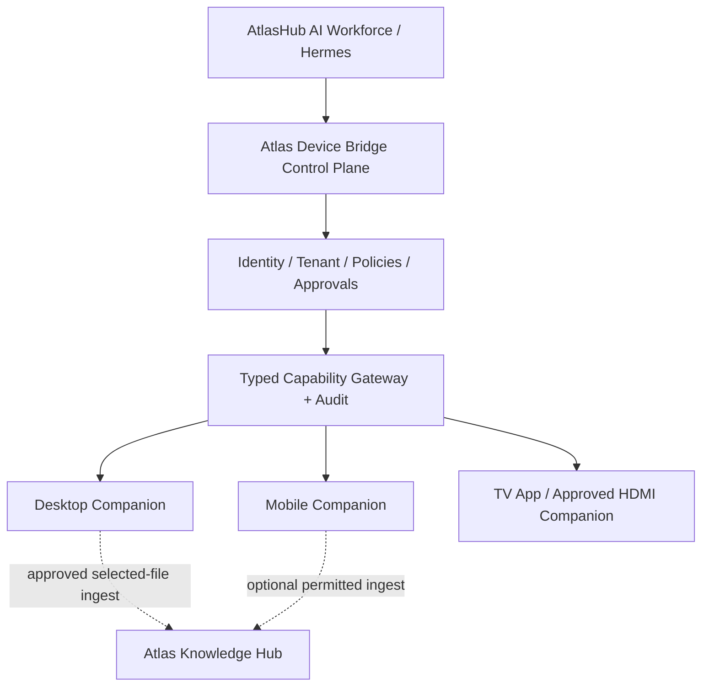

# Atlas Device Bridge (ADB)

> **AtlasHub · Consent-based AI-to-device capability bridge**  
> **Baseline v0.1.0 · 2026-10-10 · Opportunity study + engineering reference · NOT deployed**

**Atlas Device Bridge** investigates how AtlasHub/Hermes agents may securely **observe, guide, or perform narrowly authorized actions** on paired user-owned or enterprise devices: desktop, mobile, tablets, kiosks, and smart-TV experiences. ADB **is not** a surveillance product, an unconstrained remote shell, a replacement agent harness, or a new company.

**Entry points:** [Documentation index](docs/INDEX.md) · [Opportunity](docs/01-opportunity.md) · [Architecture](docs/02-architecture.md) · [Platform feasibility](docs/03-platform-matrix.md) · [Security](docs/06-security-consent.md) · [POC roadmap](docs/09-roadmap.md) · [AGENTS.md](AGENTS.md) · [Changelog](CHANGELOG.md).

## Why it matters
A business assistant can already use APIs. But many human workflows span local apps, desktops, video displays or user-selected folders. ADB adds an **opt-in device capability gateway** to the existing AtlasHub AI Workforce and Enterprise Transformation delivery models. APIs and native integrations remain preferred when available.

## Control flow





## Capability stages
1. **Observe** — user-visible contextual capture/inspection, only with local permission and scoped session.
2. **Guide** — suggest steps, highlight app controls or play approved media without taking over.
3. **Act** — execute a precisely typed allowed operation with policy checks, device/session scope, human confirmation where needed and audit.

No platform should claim arbitrary control of other apps or hidden access. iOS is largely app-centric; TV experiences favor your own player/app or approved external device rather than control of native YouTube or arbitrary overlays.

## Candidate POCs
- **A / Windows or macOS Desktop Assist:** visible companion, allowlisted UI read/action on sandbox app, short-lived session, stop control and knowledge ingestion from a deliberately selected folder.
- **B / TV Tutor:** Android/Google TV own-app experience or managed HDMI companion, approved educational video + spoken interactions + quiz; no generic third-party-app automation claims.
- **C / Android Field Companion:** foreground voice/camera/help workflow using explicit OS consent; assess iOS through its own app and App Intents/Shortcuts separately.
- **D / Assisted enterprise onboarding:** form guidance, non-API legacy ERP support, human approvals and auditing.
- **E / Accessibility/family education:** transparent tutoring, guardian or authorized adult controls for minors; no hidden monitoring.

## Current repository content

| Path | Description |
| --- | --- |
| [docs/INDEX.md](docs/INDEX.md) | Guided index and searchable IDs |
| [docs/](docs/INDEX.md) | Business thesis, architectures, device matrix, POCs, security, economics, governance, references |
| [docs/adr/](docs/adr/ADR-0001-capability-gateway.md) | Decision records with alternative scenarios |
| [contracts/](contracts/device-capability.schema.json) | Protocol and consent manifests |
| [src/](src/policy.mjs) | Runnable local policy evaluator prototype; no real devices |
| [test/](test/policy.test.mjs) | Permission, pairing and revocation tests |
| [assets/architecture.svg](assets/architecture.svg) | Editable, self-contained architecture SVG |
| [CHANGELOG.md](CHANGELOG.md) | Analysis version history |

## Safe quick start
```bash
node --version  # Node 20+
npm test
npm run demo
```

Tests use **synthetic device IDs** and do not connect to computers, cameras, microphones, screens or networks. They exercise authorization only. **There is no deployable native companion or gateway yet**.

## Interface boundaries
- [AI Workforce](https://github.com/atlashub-digital/AtlasHub-AI-WaaS) remains the customer-facing role/deployment control plane. Hermes remains an agent runtime, not a device authority.
- [Agent Packs](https://github.com/atlashub-digital/atlas-agent-packs) define versioned tool permissions and guardrails.
- [Atlas Knowledge Hub](https://github.com/atlashub-digital/Atlas-Knowledge-Hub) receives only selected approved sources with provenance and access rules; ADB does not bypass its ACL.
- [AMF](https://github.com/atlashub-digital/atlas-internal-factory) is organizationally separate; no direct control or publication rights by default.
- [Notion — Atlas Device Bridge Study](https://app.notion.com/p/3f5652fc5b9d817fa9dec6e99722562b) is the initial opportunity study.

## Baseline security rules
**Paired ≠ authorized.** Gate every request by tenant, device, person, session, declared capability, explicit local consent and risk-based approval. User-visible capture state, pause/kill switch, revocation, idempotency and audit are mandatory. Never arm arbitrary shell commands by default. Never install stealth capture, hidden camera, covert child monitoring, silent exfiltration or bypass OS permissions.

## State
Documented and runnable **policy prototype** only. Windows/macOS/Android/iOS/TV adapters are **research/POC candidates**, not delivered code. OpenClaw node integration is optional, not a requirement nor a declaration of existing interoperability.

**Public by explicit owner request.** Never commit credentials, device inventories, employee screens, tenant names/IPs or customer recordings. Later changing visibility does not erase forks/history.
