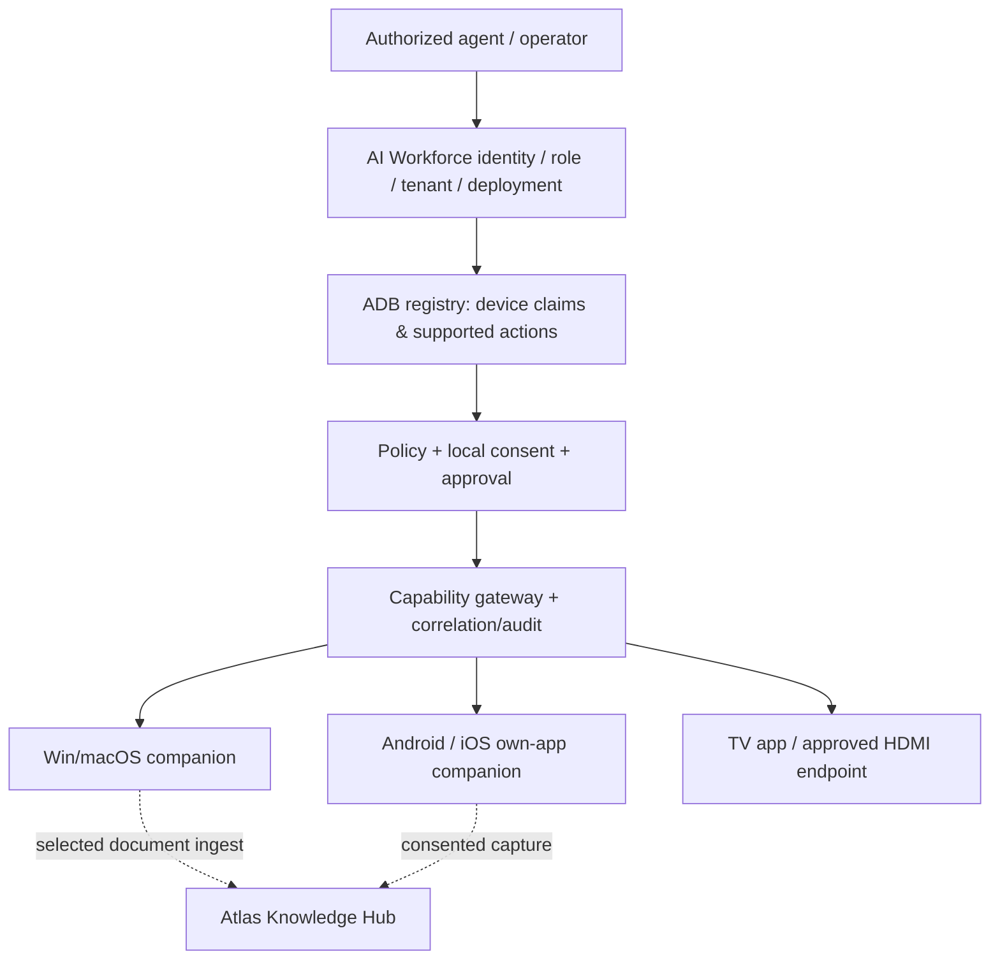

# ADB-ARCH-001 · Capability Bridge architecture

**State:** PROPOSED. ADB is **not** the control plane for the AI Workforce, not the agent harness and not a cloud desktop shell.

## Components

## Trust boundaries
- **Server plane**: verifies caller via AI Workforce signed context, resolves tenant/device/role and checks grant and risk. Reject agent-provided identities.
- **Device plane**: verifies signed command, local user consent, OS capability, foreground/presence, replay nonce and stop switch. Can deny even when cloud permits.
- **Knowledge plane**: receives only explicitly selected permitted files. It applies its **own** tenant/source authorization; bridge pairing is not knowledge grant.
- **Operations plane**: audit, rate limit, queue, circuit breaker and alerting. Never log screen pixels/audio by default.

## Protocol lifecycle
1. Device app installed willingly, user receives pairing challenge.
2. Pairing approved with short TTL and device attestation when available; device advertises supported capabilities **not blanket access**.
3. Operator starts purpose-bound session, local UI presents clear consent grant and stop button.
4. Agent proposes typed `capability.invoke` request referencing session/device; policy engine checks tenant/scopes/consent/risk/approval.
5. Companion independently validates and executes narrow operation, returns typed result/denial.
6. Expiration, disconnect, local stop or revoke kills active session, cancels pending actions and makes subsequent replay invalid.

## Transport options
- Outbound TLS WebSocket with mutual device identity (preferred for remote message channel). Keepalive and reconnect scoped; **never assume socket connection is consent**.
- HTTPS signed requests for infrequent actions where platform supports; no open inbound ports on employee PCs.
- WebRTC optional for explicit live shared-view session; signal/auth and DTLS/SRTP, clear visual indicator, short retention and tested stop. Not needed for POC-A.
- Do not expose raw OpenClaw gateways, Windows RDP, screen capture APIs or shell endpoints directly to an LLM.

## Supported canonical stack
NestJS/TypeScript gateway and PostgreSQL registry/audit matching platform tooling, Redis/BullMQ for bounded job dispatch, versioned OpenAPI/JSON Schema for commands, native scoped adapters. Agent runtime (Hermes) consumes typed tools. Optional OpenClaw adapter only behind gateway. PaperClip not required.

## Resource and tenancy
Use distinct devices/keys per customer, client-hosted deployment when contractual data residency requires. Default remote session timeouts, concurrency budgets and minimum privileges. No production infrastructure addresses/identifiers in this public repository.
